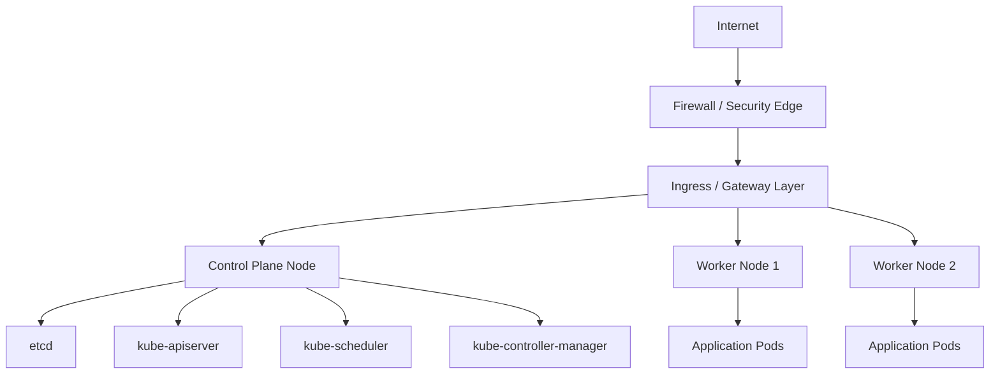

# Architecture Proposal

## Summary

The cluster will be designed as a modular kubeadm-based Kubernetes platform running on external VMs. The first implementation will remain intentionally small and conservative, while making future growth to multi-control-plane HA, ingress, observability, GitOps, and storage straightforward.

## Proposed initial topology

## Current design direction

### Recommended starting point

- 1 control-plane node for the initial environment
- 2 worker nodes
- containerd as the CRI
- kubeadm for bootstrap
- a secure network policy-enforcing CNI chosen after network review

### Why this is acceptable for Phase 1

This keeps the first deployment simple and operationally safe while staying aligned with cluster growth goals. It avoids a premature multi-control-plane deployment that would consume resources without a justified need for HA in a small external VM environment.

## Architecture trade-offs

### Single control plane

Advantages:

- lowest operational complexity
- simpler bootstrap and troubleshooting
- minimal VM requirements
- good for learning and controlled practice

Disadvantages:

- no control-plane redundancy
- cluster outage if the control-plane node is lost
- limited production availability for critical workloads

### Multi-control-plane HA

Advantages:

- higher availability
- better for production workloads
- separation of control-plane responsibilities

Disadvantages:

- more VM and networking complexity
- more operational overhead
- requires careful etcd and load-balancer planning

### Stacked etcd vs external etcd

For a small Namecheap VM deployment, stacked etcd is the most practical starting point. External etcd is a strong option only when the environment grows enough to justify dedicated distributed storage and operational separation.

### External load balancer vs HAProxy / Keepalived

If the hosting environment exposes a stable VIP or managed load balancer, that is preferred for future HA. If not, a lightweight HAProxy + Keepalived design can be used for a multi-control-plane cluster, but only after confirming the available networking model.

## Networking design

The architecture will follow a clear separation between:

- management access
- control-plane traffic
- node-to-node communication
- pod networking
- ingress traffic

The severed or exposed surface area will be minimized to the specific required ports and sources.

## Security posture

The cluster will be designed around least privilege and explicit trust boundaries.

This includes:

- SSH key-based access only
- firewall whitelisting by source IP or node subnet
- restricted Kubernetes API exposure
- role-based access control for workloads and operators
- NetworkPolicies by default
- secure credentials handling outside Git
- auditability through documentation and validation checks

## Risks to explicitly manage

- public/private network limitations on Namecheap VMs
- absence of managed load balancers or virtual private networking
- uncertain service CIDR and pod CIDR overlap with existing networks
- possible lack of egress filtering or unsupported host networking features
- limited disk or memory resources affecting storage and observability choices

## Decision status

This proposal is intentionally conservative and is awaiting infrastructure validation before approval.

## Next engineering step

Before implementation, the actual VM inventory, networking, and host capabilities must be collected and reviewed. Once approved, the project will move into Phase 2: Ansible foundation and OS hardening.
